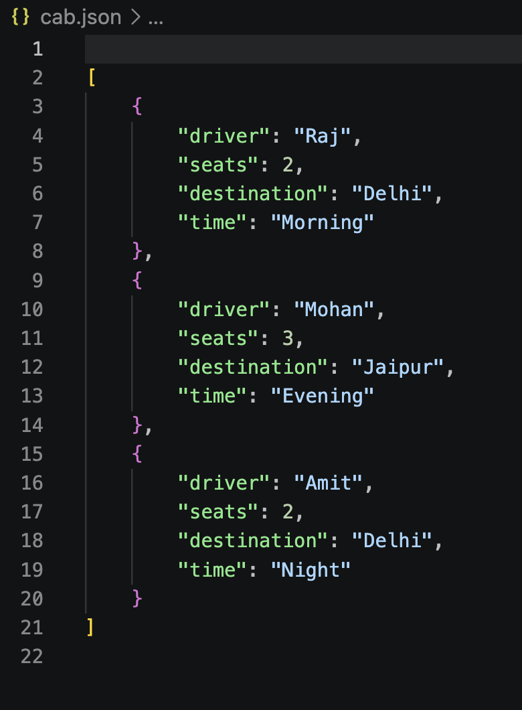
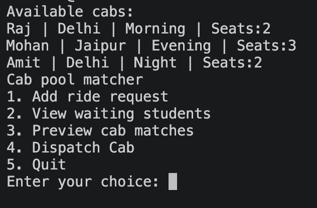
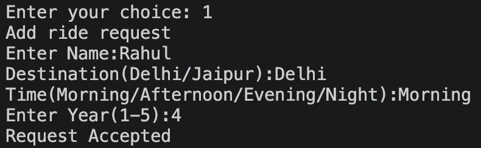
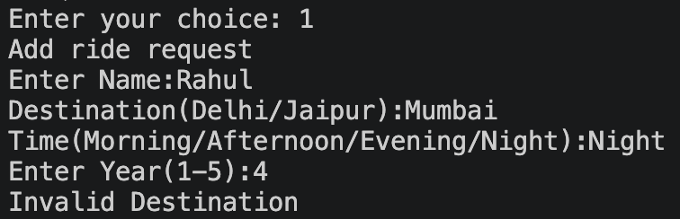
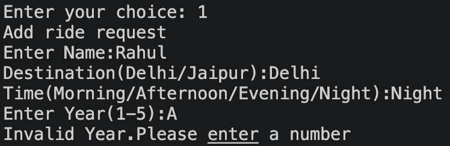
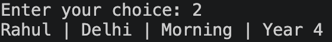
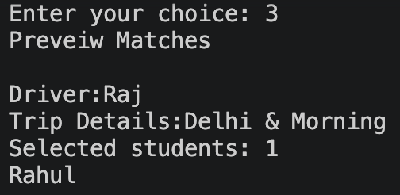
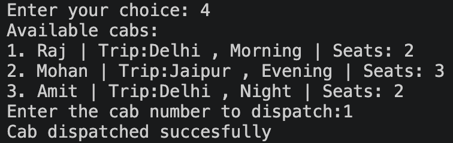

# SUTT Backend Task 1
# Cab Pool Matcher

## Project Overview
Cab pool matcher is a Python based project designed to help students travelling to Delhi and Jaipur pool cabs

Student can submit a request for a ride by Entering thier name, destination, time slot and academic year. The application matches students with available cabs based on thier destination and time slot.

The project uses heap priority queue such that senior students recieve a priority over other students.

## Features
### 1. Add Ride request
- Inputs students name.
- Ask for destination: Either Delhi or Jaipur 
- Ask for time slot: Morning, Afternoon, Evening, Night
- Accepts academic year(1-5).
- Verify if all the data enteries are valid or not.(Incase of wrong data the program does not terminate instead prints a message)
- Assigns a unique submission order for each request.
- Adda all the valid request to the waiting list.

### 2. View Waiting Students
- Display all the students currently in the waiting list.
- Shows their name, destination, time slot and academic year.
- If nobody is in waiting list, it displays a message

### 3. Load Cab Information
- Loads cab information from a JSON file named **"cab.json"**.
- Creates a cab object for each entry.
- Stores driver name, number of seats, destination and time slot.
- Stores a data of student in the cab and if the cab has left or not.

### 4. Preview Cab Matches
- Displays available cabs in their original file order.
- Matches students based on destination and time slot.
- Considers the number of available seats.
- Selects students according to academic-year priority.
- Does not modify the waiting list or assign passengers during preview.

### 5. Dispatch a cab
- Allows the user to select which cab to dispatch.
-  Selects eligible students according to priority.
- Adds selected students to the cab's passenger list.
- Removes selected students from the waiting list.
- Marks the cab as departed.
- Prevents an already-departed cab from being dispatched again.
- Allows a cab to depart even if all its seats are not occupied.

## 3. Priority System

The program uses Python's **heap** module to implement a priority queue.

Students are prioritised according to the following rules:

1. Student in higher year recieve a priority over student in lower year.
2. If two students belong to the same year, the student who submitted their request earlier gets priority.

### How priority is implemented

Each student is inserted into a heap as a tuple with the following data:

- **"-student.year"** : As the heap sorts data in ascending order and priority is given to student with higher academic year.

- **"student.order"** : Ensures in case of same year student with earlier request is selected first.

- **"student"** : Stores the actual object from RideRequest function.

> A seprate priority queue is created for every destination and time slot.

## 4. Modules used

- **json** - To load cab informatin from a json file.
- **heapq** - To create priority queue.

## 5. Project Structure

```
SUTT-Backend-Task-1/
│
├── main.py
├── cab.json
└── README.md
```

- **main.py** : Contains the application logic, classes, functions, and menu.
- **cab.json** : Stores the initial cab information.
- **README.md** : Project documentation.


## 6. Cab Data:


## 7. How to Run the Project

### Steps:

1. Download the project for GitHub.
2. Open the project directory in your terminal.
3. Ensure **main.py** and **cab.json** are in the same directory.
4. Run `python3 main.py` in the terminal.

## 8. Application Menu

When the program starts, it displays the available cabs and the following menu:



Select an option by entering its corresponding number.

### 1. Add Ride Request

Entering `1` in the menu navigates to adding a ride request and opens the following menu:



In case of wrong inputs the program prints a message instead of an Error

#### Error 1: Entering wrong destination or time slot:

In case of wrong destination or time slot a message appears:


#### Error 2: Entering a non integer in year
In case of input for year in a non integer in year following message is printed.


### 2. View waiting Students

Entering `2` prints the students added succesfully. and prints a message if there is none.


### 3. Preview Matches

Entering `3` prints list of cab drivers who have not departed and matches student as per their available seats.


### 4. Dispatch Cab

Entering `4` asks the user to enter the cab number which has to be dispatched irrespective of how many seats have been filled.


